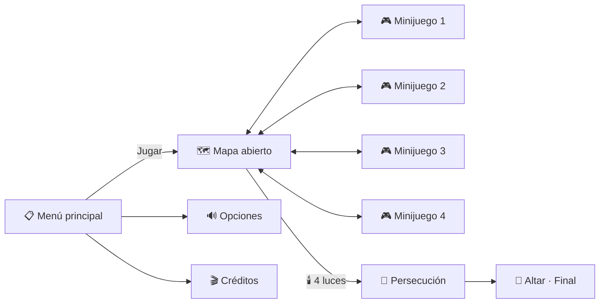

# 💀 Jam Día de Muertos

Videojuego para game jam hecho en **Godot 4.7.2**, exportado a navegador (itch.io).

Esta guía te lleva desde cero hasta ver el proyecto corriendo en tu computadora.

---

## ✅ Requisitos

| Herramienta | Versión | Dónde |
|---|---|---|
| Godot Engine | **4.7.2 estándar** (NO la .NET / C#) | https://godotengine.org/download/windows/ |
| Git | La más reciente | https://git-scm.com/downloads |
| Cuenta de GitHub | — | https://github.com |

> ⚠️ **Todo el equipo debe usar exactamente Godot 4.7.2.** Si abres el proyecto con otra versión, Godot puede modificar archivos y romper el proyecto.

---

## 1. Descargar Godot 4.7.2

1. Entra a https://godotengine.org/download/windows/ y busca **4.7.2*.
2. Descarga la versión **estándar** para tu sistema operativo (no la que dice .NET).
3. **Windows:** descomprime el `.zip` en una carpeta fija, por ejemplo `C:\Godot\`. Dentro verás dos `.exe`; usa el que **no** dice `console`. Godot no se instala: ese `.exe` es el programa. (Opcional: clic derecho → Enviar a → Escritorio para crear un acceso directo.)
4. **macOS:** descomprime y arrastra `Godot.app` a **Aplicaciones**.
5. **Linux:** descomprime y dale permisos con `chmod +x` al ejecutable.

Para confirmar la versión: abre Godot y revisa la esquina inferior del Project Manager. Debe decir `v4.7.2`.

---

## 2. Instalar Git

1. Descarga Git desde https://git-scm.com/downloads e instálalo con las opciones por defecto.
2. En Windows se instala también **Git Bash**, la terminal que usaremos.
3. Abre Git Bash (o tu terminal) y configura tu nombre y correo **una sola vez**:

```bash
git config --global user.name "Tu Nombre"
git config --global user.email "tu_correo@ejemplo.com"
```

Usa el mismo correo de tu cuenta de GitHub.

---

## 3. Aceptar la invitación al repositorio

Te llegará un correo de GitHub con la invitación al repositorio `Haziel08/JamDiaDeMuertos`. Da clic en **Accept invitation**. Sin esto no podrás subir cambios.

---

## 4. Clonar el repositorio

1. Abre Git Bash en la carpeta donde quieras guardar el proyecto (por ejemplo `Documentos`). En Windows: clic derecho dentro de la carpeta → **Open Git Bash here**.
2. Ejecuta:

```bash
git clone https://github.com/Haziel08/JamDiaDeMuertos.git
```

3. La primera vez se abrirá una ventana del navegador para iniciar sesión en GitHub; acéptala.
4. Se creará la carpeta `JamDiaDeMuertos` con el proyecto.

---

## 5. Abrir el proyecto en Godot

1. Abre Godot 4.7.2.
2. En el Project Manager da clic en **Importar** (Import).
3. Busca la carpeta `JamDiaDeMuertos` y selecciona el archivo **`project.godot`**.
4. Da clic en **Importar y Editar** (Import & Edit).
5. La primera vez tardará unos segundos importando recursos. Es normal: está creando la carpeta `.godot/`, que es caché local y **nunca** se sube al repositorio.

---

## 6. Ejecutar

Presiona **F5** (o el botón ▶ arriba a la derecha).

Debe abrirse una ventana con el texto:

### EJECUCIÓN CORRECTA JAM DÍA DE MUERTOS

Si lo ves, ¡todo quedó listo! 🎉

---

## 7. Estructura del proyecto
---

## 🗂️ Estructura del proyecto

Organizamos el proyecto **por funcionalidad**: cada parte del juego tiene su propia carpeta con sus escenas, scripts y recursos. Así cada quien trabaja en lo suyo sin romper lo de los demás.

```
📁 res://
├── ⚙️ autoload/                 → 🌐 GLOBAL · scripts activos en todo el juego
│   ├── game_state.gd            → luces recolectadas y minijuegos completados
│   ├── audio_manager.gd         → reproducir música y efectos
│   ├── scene_manager.gd         → cambiar de escena con transición
│   └── settings.gd              → guardar volumen y opciones
│
├── 🧩 common/                   → 🌐 GLOBAL · recursos compartidos
│   ├── components/              → piezas reutilizables (diálogos, transiciones, pausa)
│   ├── fonts/
│   ├── music/
│   ├── sfx/
│   ├── themes/                  → estilo visual de botones y UI
│   └── ui/
│
├── 💀 player/                   → personaje que explora el mapa
│   ├── sprites/
│   └── sfx/
│
├── 📋 menus/
│   ├── main_menu/               → Jugar · Opciones · Créditos
│   ├── options/                 → volumen de música y efectos
│   ├── credits/
│   └── hud/                     → contador de luces 🕯️ 0/4
│
├── 🗺️ world/                    → mapa abierto
│   ├── tilesets/
│   ├── props/                   → velas, cempasúchil, tumbas
│   ├── npcs/                    → personajes y sus diálogos
│   └── minigame_zones/          → entradas a cada minijuego
│
├── 🎮 minigames/
│   ├── minigame_1/              → 🕯️ luz 1
│   ├── minigame_2/              → 🕯️ luz 2
│   ├── minigame_3/              → 🕯️ luz 3
│   └── minigame_4/              → 🕯️ luz 4
│       ├── scripts/
│       ├── scenes/
│       ├── sprites/
│       └── sfx/
│
└── 🏃 finale/                   → persecución final hasta el altar 🌼
    ├── scripts/
    ├── sprites/
    └── sfx/
```

## 🔄 Flujo del juego



## 🤝 Cómo se conectan las partes

Los minijuegos **no dependen del mapa** y el mapa **no depende de los minijuegos**. Todo pasa por los autoloads:

```gdscript
# Al ganar un minijuego:
GameState.complete_minigame("minigame_1")   # entrega la luz 🕯️
SceneManager.go_to_world()                  # regresa al mapa
```

Puedes probar tu minijuego solo, sin el resto del juego: abre tu escena y presiona **F6** (ejecutar escena actual).


## 🧯 Problemas comunes

**"Este proyecto fue creado con otra versión de Godot" / te pide convertir el proyecto**
Estás usando una versión distinta a la 4.7.2. Cierra **sin convertir** y descarga la versión correcta.

**Al darle F5 pregunta cuál es la escena principal**
Probablemente abriste otra carpeta. Asegúrate de haber importado el `project.godot` de la carpeta clonada.

**`git clone` dice "Repository not found"**
No has aceptado la invitación o no iniciaste sesión con la cuenta correcta de GitHub.

**`git` no se reconoce como comando**
Git no está instalado o no reiniciaste la terminal después de instalarlo.

---

## 📏 Recomendaciones

1. **Nadie actualiza Godot**. Todos en 4.7.2.
2. **Nunca subas la carpeta `.godot/`** (el `.gitignore` ya lo evita; no lo borres).
3. **Antes de empezar a trabajar**, trae los cambios de los demás:
   ```bash
   git pull
   ```
4. **Avisa al equipo qué escena vas a editar**, para que dos personas no modifiquen la misma escena al mismo tiempo (los conflictos en archivos `.tscn` son difíciles de resolver).
